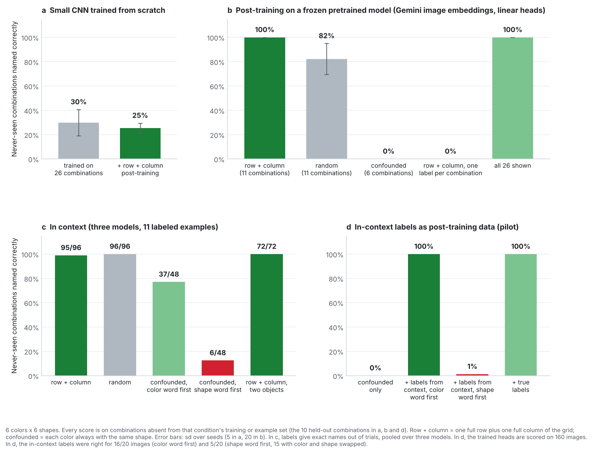
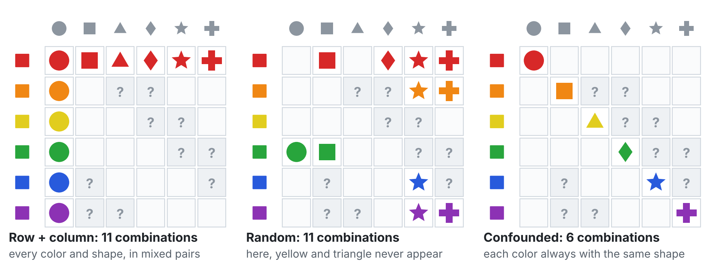
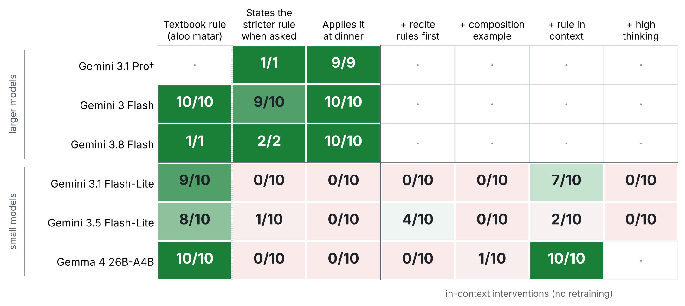
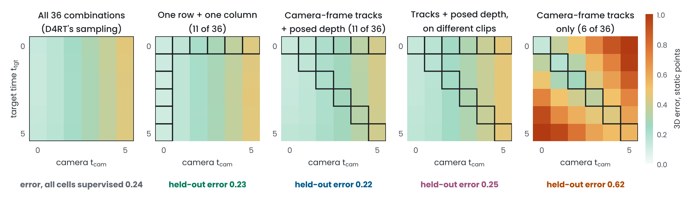

# Composition after pretraining

If a model knows "red" and "rectangle", can a few examples teach it every color-shape combination, so that the examples needed grow with **colors plus shapes** rather than **colors times shapes**? This is hard to exploit while pretraining a large model, so this repo tests the two later stages where it could be used instead: **post-training** and **in-context learning**. Part 2 runs a pair of cultural-knowledge queries on newer Gemini models, including Gemini 4 Argon. Part 3 runs the color-shape test inside a D4RT-style model, on its time-camera queries.



## Results in brief

1. **After pretraining, 11 well-chosen examples cover all 36 combinations.** One row plus one column of a 6 x 6 color-shape grid (6 + 6 - 1 = 11 combinations) was enough to name all 25 other combinations: in post-training, with linear heads on frozen Gemini image embeddings, in **20 of 20** runs; in context, across three models, in **95 of 96** answers. A small CNN trained from scratch on 26 combinations names only **30%** of the held-out ones.
2. **Which combinations matters more than how many.** 11 random combinations reach **82%** in post-training. 6 confounded ones, where each color always comes with the same shape, reach **0%** in post-training: the examples never show which attribute each label refers to.
3. **In context, the model fills that gap with its language prior.** Given confounded examples, 95 of 96 answers followed one of the two readings the examples allow, and **79 of 96** took the first word as the color, as in English. So the models were mostly right when the made-up language put the color word first (**37/48**) and wrong when it put the shape word first (**6/48**).
4. **In-context labels work as post-training data (pilot).** Labels produced by the model in context took confounded post-training from **0% to 100%**. When the word order conflicted with the prior, the labels carried the error with them (**1%**, with color and shape swapped on 92% of images).
5. **The Jain pair on newer models.** Gemini 4 Argon and Gemini 3.8 Flash apply the stricter Paryushan rule in **10 of 10** dinner plans each. Gemini 3.5 Flash-Lite, the newest small model, applies it in **0 of 10**, while still handling the basic query (**8 of 10**). Details in [pair/](pair/README.md).
6. **The same rule inside a D4RT-style model.** For queries (u, v, t_src, t_tgt, t_cam), supervising one row and one column of the 6 x 6 time-camera grid (11 of 36 combinations) answered the unseen combinations as well as supervising all 36 (**0.23** vs **0.24** 3D error on static points, 3 seeds). Supervising only t_tgt = t_cam, which is what camera-frame tracks give, did not: **2.5x** the error, worse on 100 of 100 test scenes and in every seed; adding one row of posed depth fixed it (**0.22**), even when the depth came from other clips (**0.25**). Details in [sparse_queries/](sparse_queries/README.md).

## 1. Composition after pretraining

### Setup

**Grid.** 6 colors x 6 shapes = 36 combinations. In settings a, b and d, ten combinations are held out of every training set and unlabeled pool, and are used only for scoring. In context (c), each trial draws its own example set and asks for one combination outside it.

**Example sets.** All small, and differing only in which combinations they contain:

| Set | Combinations | What it shows |
|---|---|---|
| row + column | 11: one full row and one full column of the grid | every color and every shape, none tied to a single partner |
| random | 11 drawn from the 26 shown | the same budget without design |
| confounded | 6: each color always with the same shape | every color and every shape, but they never vary independently |



*Drawn cells are the combinations in each set. Cells marked ? are the 10 held-out combinations, on which settings a, b and d are scored. The random set shown is the one from seed 0, where yellow and triangle never appear. In context (c), every trial draws a new set of the same kind.*

**Settings.**

- **a. From scratch.** A small CNN in JAX/Flax with a color head and a shape head, trained on 12,000 images of the 26 shown combinations, then optionally post-trained on 220 row + column images. 5 seeds. [`composition/posttrain.py`](composition/posttrain.py)
- **b. Post-training on a frozen pretrained model.** Images embedded with the Gemini API image embedding model (`gemini-embedding-2`, 768 dimensions). Ridge-regression heads trained on about 110 images, with either one label per attribute (a color head and a shape head) or one label per combination. 20 seeds. [`composition/posttrain_probe.js`](composition/posttrain_probe.js)
- **c. In context.** Gemini 3.5 Flash-Lite, Gemini 3.1 Flash-Lite and Gemma 4 26B-A4B see 11 labeled pictures with made-up two-word names ("dax wug"), then name a new picture. Made-up words keep English color names out, so the names have to be learned from the examples. The made-up language puts either the color word or the shape word first. Each trial draws a new example set of the chosen kind (a random row and column; 11 random combinations; or the 6 pairs of a confounded set, some shown twice) and new words, then asks for a combination outside the set whose color and shape both appear in it. One extra test shows two objects and asks for one of them. [`composition/icl_runner.js`](composition/icl_runner.js)
- **d. Pilot: in-context labels as post-training data.** The labeled post-training set is confounded (6 combinations, 108 images). Gemini 3.5 Flash-Lite sees 11 of those labeled images in context and names one unlabeled image of each of the other 20 shown combinations. The heads from (b) are then trained on both and scored on the 10 held-out combinations. [`composition/icl_to_posttrain.js`](composition/icl_to_posttrain.js)

### Results

Share of never-seen combinations named correctly (both color and shape right):

| Setting | row + column | random | confounded |
|---|---|---|---|
| a. Small CNN from scratch | 25% (30% before row + column post-training) | | |
| b. Post-training, one label per attribute | **100%** (20/20 seeds) | 82% (4/20 seeds at 100%) | 0% |
| b. Post-training, one label per combination | 0% | | |
| c. In context, three models | **95/96** | 96/96 | 37/48 color word first, 6/48 shape word first |
| c. In context, two objects in the picture | 72/72, no word taken from the other object | | |

Pilot (d), scored on 160 images of the 10 held-out combinations:

| Post-training data | In-context labels right | Held-out combinations right |
|---|---|---|
| confounded only | | 0% |
| + in-context labels, color word first | 16/20 | **100%** |
| + in-context labels, shape word first | 5/20 (15 swapped) | 1% (92% swapped) |
| + true labels for the same 20 images | 20/20 | 100% |

All per-run numbers are in [results/composition_summary.md](results/composition_summary.md).

### What it means

- **Composition is cheap after pretraining, not before it.** The same row + column examples that give 100% on frozen Gemini features give 25% for a CNN trained from scratch, which gets the color of held-out combinations right (97%) but not the shape (27%). The saving comes from attributes the pretrained model already represents separately, and it grows with the grid: C + S - 1 examples for C x S combinations.
- **The examples must be deconfounded.** Each attribute value has to appear with more than one partner. In post-training, random sets miss some values (82%), and confounded sets give a learner no way to tell the attributes apart (0%).
- **The targets must be factorized.** One label per attribute composes; one label per combination cannot name a combination it has not seen (0%).
- **In context, priors decide what the examples leave open.** That is why in-context learning handled confounded examples that post-training could not, and also why it failed when the prior pointed the wrong way.
- **The two stages can be combined.** In-context labels fixed the confounded post-training set, and they also passed the prior's error into it.

### Where this could go

The row + column result bears on factorized queries in perception models. In [D4RT (Zhang et al., 2026)](https://arxiv.org/abs/2512.08924), a query combines a point, a time and a camera; the matching test is whether sparse supervision covers held-out time-camera combinations when the two vary independently, and fails when they are tied. The pilot is a perception version of the augmentation in [Lampinen et al. (2025)](https://arxiv.org/abs/2505.00661), who found that in-context learning generalizes more flexibly than fine-tuning and improved fine-tuning by adding in-context inferences to its data. Here the in-context inferences are labels for the combinations a post-training set leaves confounded. The next tests are real attribute-object pairs, which natural data confounds (object and material in images, as in MIT-States; verb and object in video), and compounds whose parts change each other's meaning ("red wine", "fake gun"), where a prior that composes additively should fail. The open question is when the model's in-context prior can be trusted to fill gaps in post-training data, and how to detect when it cannot.

### Caveats

- Synthetic images and a 6 x 6 grid. Real attributes interact more.
- Post-training here means light heads on frozen embeddings, not fine-tuning the model itself.
- In context, 16 trials per model and cell (12 for two-object pictures), with one prompt template.
- The pilot uses one image per unlabeled combination and one teacher model.

## 2. The Jain pair across Gemini generations

Two dinner requests for Jain guests: one needs the basic rule (no root vegetables, so no potatoes in aloo matar), the other a rarer festival rule on top (during Paryushan many families give up all fresh vegetables). The larger models, including Gemini 4 Argon, apply the rarer rule in 40 of 40 dinner plans; the small models, including the newest Gemini 3.5 Flash-Lite, in 0 of 30. The gap is missing knowledge: asked directly, the small models state the stricter rule in 1 of 30 answers (the larger models in 39 of 40), and one sentence stating it lifts Gemma 4 from 0/10 to 10/10, while a high thinking level helps none of them (0/30). Full results, method and sources: [pair/README.md](pair/README.md).



## 3. Sparse training queries in a D4RT-style model

D4RT answers queries (u, v, t_src, t_tgt, t_cam): where the point seen at pixel (u, v) of frame t_src is at time t_tgt, in the coordinates of camera t_cam. It is trained on every time-camera combination, but real labels often cover only some: camera-frame 3D tracks give only t_tgt = t_cam, and posed depth only t_tgt = t_src. A small D4RT-style model, trained on synthetic clips with a moving camera and moving objects, shows which combinations need supervision.



As with colors and shapes, the combinations do not need to be crossed everywhere, only to vary independently somewhere. Tied labels leave the model unable to tell which index sets the camera, and one row of posed depth is enough to fix that, even when it comes from other clips. Setup, all label sets, statistics, the post-training version and caveats: [sparse_queries/](sparse_queries/README.md).

## Reproduce

```bash
pip install -r requirements.txt

# a. small CNN from scratch (CPU, about 15 minutes)
python composition/posttrain.py --seeds 5 --p_home -1 0.95 \
    --designs none correlated cross all26 --out results/scratch_cnn.json

# b, c, d. browser runners: open any https page, set sessionStorage.__PK to a Gemini API key,
# then paste each file into the DevTools console in this order:
#   composition/posttrain_probe.js    await PP.embedAll(); await PP.runAll(20)
#   composition/icl_runner.js         ICL.add(model, design, order, binding, n); ICL.start()
#   composition/icl_to_posttrain.js   await IP.teach('adj'); await IP.teach('noun'); IP.report()

python composition/analyze.py     # results/composition_summary.md and the figures
```

The Jain pair and the D4RT-style experiment have their own instructions in [pair/README.md](pair/README.md#reproduce) and [sparse_queries/README.md](sparse_queries/README.md#reproduce).

## Layout

```
composition/   shapes.py, posttrain.py (JAX), browser runners (*.js), analyze.py
results/       raw results for part 1: scratch_cnn.json, posttrain_probe_runs.csv,
               icl_records.csv, icl_to_posttrain_*.{csv,json}, summary and figures
pair/          the Jain pair: prompts, rubric, runner, grader, verdicts, results
sparse_queries/ D4RT-style model with sparse time-camera supervision: scenes, model, runs, report
report/        two-page summary (PDF)
```

## References

- A. K. Lampinen, A. Chaudhry, S. C. Y. Chan, C. Wild, D. Wan, A. Ku, J. Bornschein, R. Pascanu, M. Shanahan, J. L. McClelland. *On the generalization of language models from in-context learning and finetuning: a controlled study.* arXiv:2505.00661, 2025.
- C. Zhang, G. Le Moing, S. Koppula, I. Rocco, L. Momeni, J. Xie, S. Sun, R. Sukthankar, J. K. Barral, R. Hadsell, Z. Ghahramani, A. Zisserman, J. Zhang, M. S. M. Sajjadi. *Efficiently reconstructing dynamic scenes one D4RT at a time.* CVPR, 2026.
- P. Isola, J. J. Lim, E. H. Adelson. *Discovering states and transformations in image collections* (MIT-States). CVPR, 2015.
