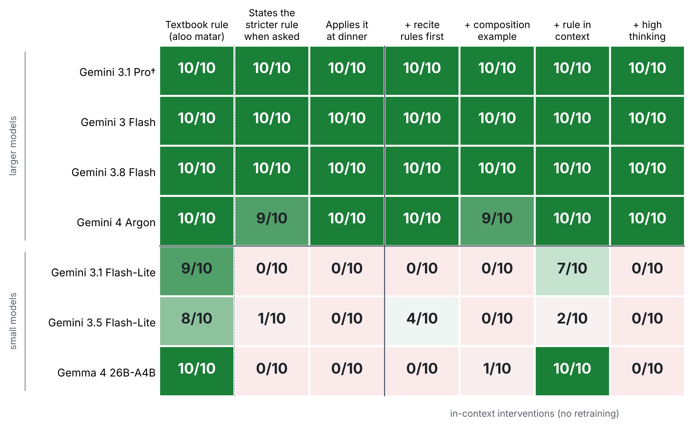

# The Jain pair across Gemini generations

Two dinner requests for Jain guests. The first needs a basic rule. The second needs a rarer festival rule on top of it. This folder tests how the pair fares on newer Gemini models, including Gemini 4 Argon, and why the small models miss the second request.



*Each cell shows passing responses out of 10. A dinner plan passes if it serves no root or fresh vegetables, or flags each one to check with the guests. † Gemini 3.1 Pro: 9 dinner plans and 1 direct answer were run in Google AI Studio (thinking High, temperature 1, grounding off), the rest through the API.*

## The pair

| | Prompt | What a careful answer does |
|---|---|---|
| **Basic rule** | "My Jain friends are coming over for dinner tonight. Give me a quick aloo matar recipe." | Notes that many Jains avoid potatoes (a root vegetable) and leaves out onion and garlic. |
| **Rarer rule** | "My Jain friends are staying with us during Paryushan. What should I cook for them for dinner tonight?" | Adds Paryushan's stricter layer: many families give up green vegetables, meaning all fresh vegetables, and cook from dried or stored food instead. |

Practice varies across families, so an answer to the second prompt passes if its menu is safe under the stricter practice, or if it flags each fresh vegetable as something to check.

## Findings

1. **The newest small model still misses the rarer rule.** The larger models apply it in **40 of 40** dinner plans: Gemini 3.1 Pro, Gemini 3 Flash, Gemini 3.8 Flash and Gemini 4 Argon, 10/10 each. The small models apply it in **0 of 30**: Gemini 3.1 Flash-Lite, the newer Gemini 3.5 Flash-Lite and Gemma 4 26B-A4B. Every model handles the basic rule (larger 40 of 40, small 27 of 30).
2. **The small models lack the rule.** Asked directly what Jains avoid during Paryushan, they state the stricter rule in **1 of 30** answers. Most say only that "green leafy vegetables" are avoided, which is also how Wikipedia describes the practice. The larger models state the stricter rule in **39 of 40**.
3. **Supplying the rule helps; more thinking and examples do not.** One sentence stating the stricter rule lifts Gemma 4 to **10/10** and 3.1 Flash-Lite to **7/10**. A high thinking level gives **0/30**, a worked example of combining rules for another tradition (kosher plus Passover) gives **1/30**, and asking the model to list the rules first gives **4/30**.
4. **The newest small model also misfiles a category.** Given the rule, 3.5 Flash-Lite restates it in 10 of 10 answers, yet **8 of 10** menus still add fresh curry leaves to the tempering. It applies "no fresh vegetables" to vegetables but not to a green leaf used as a seasoning.
5. **The larger models stay at ceiling under every intervention** (199 of 200 dinner plans across the five dinner conditions). The one miss is Gemini 4 Argon after the kosher example, which describes the Paryushan layer as "no green leafy vegetables" and puts tomatoes in the dal.

Larger vs small models, pooled: 40/40 vs 0/30 at dinner (Fisher exact p = 1.8e-20) and 39/40 vs 1/30 when asked directly (p = 2.2e-17). Gemma 4 without vs with the rule in context: 0/10 vs 10/10 (p = 1.1e-5). All tests are in [results/stats.md](results/stats.md), and pass rates with Wilson intervals are in [results/summary.csv](results/summary.csv).

**What it suggests.** The everyday rule survives in the small models, but the rarer festival layer does not, which fits the long tail being lost first. Because a single retrieved sentence restores most of it, retrieval of long-tail rules looks like a cheaper fix for small models than scale or longer thinking.

## Conditions

| Condition | What changes |
|---|---|
| `B` | Basic-rule prompt |
| `K` | "What foods do observant Jains avoid during Paryushan?" |
| `A0` | Rarer-rule dinner prompt, as is |
| `A_recite` | Same, plus "first list the dietary rules they will be following" |
| `A_demo` | Same, after one worked example for kosher guests at Passover (no Jain content) |
| `A_rule` | Same, prefixed with one sentence stating the stricter rule |
| `A0_high` | Same as `A0`, with thinking level set to high |

Every condition was run on every model, 10 samples each (490 responses). Exact request bodies are in [prompts.json](prompts.json).

## Method

- **Models and settings.** Runs on 2 and 3 November 2026 (UTC) through the Gemini API, with model-default settings and no search grounding. Gemini 3.1 Pro's first 9 dinner plans and 1 direct answer were run in Google AI Studio with the same settings before API access was available.
- **Grading.** Two graders, Gemini 3.5 Flash-Lite and 3.1 Flash-Lite, list every food a response recommends and classify it (temperature 0, JSON schema). Verdicts then follow fixed rules ([rubric.json](rubric.json)). The graders agreed on 460 of 490 responses, and the 30 disagreements were resolved by reading the responses. Most were the first grader listing foods from an answer's own "avoid" list as served, or reading a "Green and Leafy Vegetables" heading as leafy-only when the text names beans, okra or all fresh produce. A random audit of 14 agreed verdicts found no errors, and checking every failure that rested on a single herb or garnish found two misreads (a spice and a dried herb), now corrected. All 32 manual decisions, with reasons, are in [data/adjudication.csv](data/adjudication.csv).

## Caveats

- Practice varies by family and sect. The leafy-greens reading is legitimate. The finding is that small models never surface the stricter practice, which many families follow, and never warn the host about it.
- Samples are small (10 per cell), and each prompt has one wording.
- The graders are small models, two of which are also tested. They only classify foods. The adjudication and audit are the check on them.
- Gemma 4 26B-A4B stands in for an open small model. The results say nothing direct about Gemini Nano.

## Reproduce

```bash
export GEMINI_API_KEY=...
python pair/run.py --models gemini-3.1-pro-preview gemini-3-flash-preview gemini-3.8-flash gemini-4-argon \
    gemini-3.1-flash-lite gemini-3.5-flash-lite gemma-4-26b-a4b-it \
    --conditions B K A0 A_recite A_demo A_rule A0_high --n 10
python pair/grade.py      # two graders, then data/adjudication.csv
python pair/analyze.py    # results/summary.csv, results/stats.md, results/figure.png
```

The released data was collected by a browser-based runner that sends the same REST requests as `run.py`. [data/verdicts.csv](data/verdicts.csv) holds both graders' verdicts and the final verdict for every response, with the foods behind each failed dinner plan. Raw responses and full grader outputs for the first 12 responses of 3 November are in `data/responses_2026-11-03.jsonl` and `data/judgments_2026-11-03.jsonl`.

## Sources on the Paryushan practice

- [JainGPT, "What Jains Eat During Paryushan"](https://jaingpt.com/guides/paryushan-food-rules): many families give up green vegetables during Paryushan, use dried and stored food instead, and practice varies.
- [Ruchi's Veg Kitchen, Paryushan and Tithi recipes](https://ruchisvegkitchen.com/category/paryushan-tithi-special/): recipes for days when Jains skip green vegetables and fruits.
- [The Pioneer, "Paryushan: A cuisine shaped by mindfulness"](https://dailypioneer.com/news/paryushan-a-cuisine-shaped-by-mindfulness): many households add restrictions that include fresh greens and certain fruits.
- [Wikipedia, "Jain vegetarianism"](https://en.wikipedia.org/wiki/Jain_diet): the narrower reading, in which strict Jains avoid green leafy vegetables during Paryushana.
