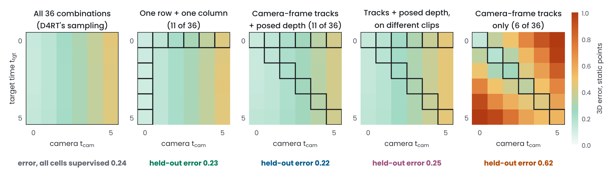
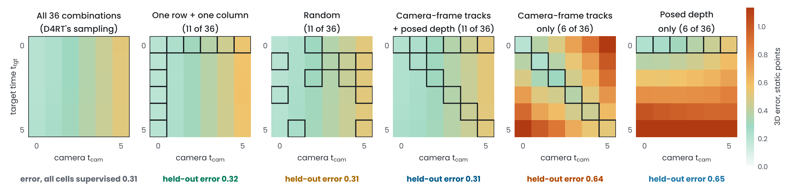

# Sparse training queries in a D4RT-style model

D4RT ([Zhang et al., CVPR 2026](https://arxiv.org/abs/2512.08924)) answers queries
q = (u, v, t_src, t_tgt, t_cam): where the point seen at pixel (u, v) of frame t_src is at time
t_tgt, in the coordinates of the camera of frame t_cam. Its training draws t_tgt and t_cam
independently (and sets them equal 40% of the time), so every time-camera combination is supervised.

Real labels are often narrower. Camera-frame 3D tracks, from 2D tracks plus per-frame depth, only give
queries with t_tgt = t_cam. Posed depth only gives t_tgt = t_src. This folder asks whether a D4RT-style
model answers the combinations it was never trained on, with the same test as the color-shape grid in
the main README: supervise one row and one column of the (t_tgt, t_cam) grid, or only its diagonal,
and score the rest.

## Results

Errors are 3D distances in scene units (the spheres have radius 0.55 to 0.8) on 100 new scenes, for combinations with
t_src, t_tgt and t_cam all different, which none of the sparse label sets contains. Static points give the cleanest
readout: their position depends only on the camera, and the model learns camera motion well. It tracks moving objects
only partly (see the caveats), so moving points are noisier but show the same ordering.

**End to end** (mean ± sd over 3 seeds; each model trained from scratch with the same number of training queries).
Ratios are errors relative to the all-36 model, with 95% intervals from a two-level bootstrap that resamples both the
training seeds and the 100 test scenes; p-values are Welch's t-tests on the seed means, Holm-corrected across the
comparisons. Drift: how far a model moves a static point, seen from one camera, when only the target time changes
(0 is right).

| Supervised combinations | Cells per t_src | Static points | Ratio to all 36 | Moving points | Ratio to all 36 | Drift |
|---|---|---|---|---|---|---|
| All 36 (D4RT's sampling) | 36 | 0.242 ± 0.003 | reference | 0.710 ± 0.007 | reference | 0.04 |
| One row + one column | 11 | 0.230 ± 0.018 | 0.95 [0.87, 1.03], p 0.72 | 0.745 ± 0.008 | 1.05 [1.03, 1.07], p 0.03 | 0.03 |
| Camera-frame tracks + posed depth | 11 | 0.222 ± 0.009 | 0.92 [0.87, 0.98], p 0.18 | 0.734 ± 0.007 | 1.03 [1.01, 1.06], p 0.05 | 0.04 |
| Tracks + posed depth, different clips | 6 per clip | 0.247 ± 0.008 | 1.02 [0.97, 1.08], p 0.72 | 0.735 ± 0.005 | 1.03 [1.01, 1.06], p 0.04 | 0.04 |
| Camera-frame tracks only | 6 | 0.617 ± 0.021 | 2.54 [2.37, 2.73], p 0.006 | 0.851 ± 0.014 | 1.20 [1.15, 1.25], p 0.006 | 0.33 |
| Assume nothing moves | - | 1.003 | | 1.180 | | - |



One row and one column, and camera-frame tracks plus posed depth, are no worse than all 36 on static points (the 95%
intervals of their error ratios end at 1.03 and 0.98) and cost 5% and 3% on moving points.
Camera-frame tracks alone give 2.5 times the error on static points, on 100 of 100 test scenes and in every
seed, and the model moves static points as the target time changes (drift 0.33, against
0.03 to 0.04 for the other label sets). Posed depth fixes this even when it comes from
other clips: with tracks on half of the clips and posed depth on the other half, so that no clip has both, the error is
0.247 (ratio to all 36: 1.02 [0.97, 1.08]). Having both on the same clips gives
0.222 (different clips against same clips: ratio 1.11 [1.04, 1.18],
Welch p 0.05).

**Post-training.** A fresh decoder on the frozen encoder of the seed-0 all-36 model, trained with each label set
(2,500 steps; mean ± sd over seeds; p from Welch's t-test on the seed means against the all-36 decoder, Holm-corrected).

| Supervised combinations | Seeds | Static points | Difference to all 36 | Moving points | Drift |
|---|---|---|---|---|---|
| All 36 (D4RT's sampling) | 3 | 0.307 ± 0.009 | reference | 0.754 ± 0.009 | 0.05 |
| One row + one column | 3 | 0.319 ± 0.004 | +0.012, p 0.70 | 0.775 ± 0.010 | 0.04 |
| Random | 3 | 0.307 ± 0.008 | +0.000, p 1.00 | 0.765 ± 0.050 | 0.05 |
| Camera-frame tracks + posed depth | 3 | 0.311 ± 0.006 | +0.005, p 1.00 | 0.762 ± 0.009 | 0.05 |
| Camera-frame tracks only | 3 | 0.642 ± 0.051 | +0.336, p 0.04 | 0.906 ± 0.024 | 0.34 |
| Posed depth only | 3 | 0.650 ± 0.014 | +0.343, p 1.5e-04 | 0.895 ± 0.006 | 0.34 |



Every label set in which the time indices vary independently somewhere matches all 36, random cells included. The two
that keep a pair of indices tied fail in different ways. With camera-frame tracks only (t_tgt = t_cam) the error grows
away from the diagonal: nothing in the labels says which index sets the camera. With posed depth only (t_tgt = t_src)
it grows with the target time: the model never saw time change, so it moves static points with it.

For static points the right answer is the point in camera t_cam. The end-to-end tracks-only model (seed 0) lands between that and the same point in camera t_tgt: closer to the truth in 57% of queries and to the camera-t_tgt answer in 43% ([readings_tied.json](../results/sparse_queries/readings_tied.json)).

All statistics: [stats.md](../results/sparse_queries/stats.md).

## Caveats

- A small model on synthetic 32 x 32 clips of 6 frames. The camera keeps a fixed height and tilt, so metric depth is
  recoverable from a single frame.
- The model learns camera motion well but tracks moving objects only partly: even with all 36 combinations its error on
  moving points grows with the time gap (0.71 against 1.18 for assuming nothing moves). Static points,
  whose answer depends only on the camera, give the cleanest comparison.
- Three seeds per label set. The intervals resample seeds as well as scenes, but with three seeds the seed-to-seed
  spread is itself only roughly known.
- Next: Kubric clips at higher resolution, and how small the share of posed-depth clips can be.

## Setup

- **Scenes** (`scenes.py`). 6 frames of 32 x 32 video: a camera at fixed height and tilt that slides and pans over a
  tiled floor, 3 static spheres and 2 moving ones. Every pixel keeps its object id and 3D point, so any query has
  exact ground truth.
- **Model** (`d4rt_small.py`). D4RT's interface at small scale. Encoder: a 3x3 convolution over each frame and its
  difference from the previous frame (D4RT's tubelets span two frames), 8 x 8 patches, and a 3-layer transformer
  over all frames. Decoder: the query is the sum of a Fourier embedding of (u, v), learned embeddings of t_src, t_tgt
  and t_cam, and an embedding of the 9 x 9 patch around (u, v); 3 layers of cross-attention to the encoder tokens,
  with no attention between queries. Loss: L1 on sign(x) log(1 + |x|) of the 3D point.
- **Label sets.** For every source frame, training queries are restricted to a subset of the 6 x 6 (t_tgt, t_cam)
  grid. All label sets get the same number of training queries (8 clips x 128 per step, half on moving objects).

| Label set | Cells per t_src | Supervised cells | Real labels that give it |
|---|---|---|---|
| All 36 | 36 | every (t_tgt, t_cam); t_tgt = t_cam 40% of the time | D4RT's sampling |
| One row + one column | 11 | t_tgt = t_src, or t_cam = t_src | posed depth plus tracks in the source camera |
| Random | 11 | 11 cells drawn at random for each t_src | |
| Camera-frame tracks + posed depth | 11 | t_tgt = t_cam, or t_tgt = t_src | 2D tracks and per-frame depth, plus posed depth |
| Tracks + posed depth, different clips | 6 per clip, 11 overall | t_tgt = t_cam on half of the clips, t_tgt = t_src on the other half | tracks from videos without poses, posed depth from other videos |
| Camera-frame tracks only | 6 | t_tgt = t_cam | 2D tracks and per-frame depth, no camera poses |
| Posed depth only | 6 | t_tgt = t_src | depth maps with camera poses |

- **Test.** 100 new scenes; for every frame, 6 points on moving objects and 6 static points, each queried at all 36
  combinations. The headline numbers use the combinations with t_src, t_tgt and t_cam all different, which no sparse
  label set supervises.

## Files

| File | What it does |
|---|---|
| `scenes.py` | Procedural clips and exact ground truth for any query |
| `d4rt_small.py` | The model, the supervision designs, end-to-end training and evaluation |
| `decoder_only.py` | Fresh decoders on a frozen encoder, one per label set and seed (post-training version) |
| `stats.py` | Seed spread, two-level (seed and scene) bootstrap intervals, Welch and Wilcoxon tests, Holm correction |
| `drift.py` | How far a model moves a static point when only the target time changes |
| `readings.py` | Where the tracks-only model's answers land between the readings its labels cannot tell apart |
| `reeval.py` | Re-scores saved models (adds per-scene errors) |
| `analyze.py` | Tables and figures in `../results/sparse_queries/` |
| `runs/`, `runs_dec/` | Per-run results (`*_eval.json`, `*_train.json`, supervised-cell masks) |
| `report/` | Two-page summary (PDF) and its source |

## Reproduce

```bash
pip install -r ../requirements.txt
for s in 0 1 2; do for d in full rowcol tied tiedrow split; do
  python d4rt_small.py --design $d --seed $s --steps 5000 --out runs
done; done
python decoder_only.py --encoder runs/full_s0 --designs full rowcol random tiedrow tied row --seeds 0 1 2 --steps 2500 --out runs_dec
python readings.py --run runs/tied_s0 --out ../results/sparse_queries/readings_tied.json
python drift.py --runs runs --out ../results/sparse_queries/drift.json
python drift.py --runs runs --decoders runs_dec --out ../results/sparse_queries/drift_decoder_only.json
python analyze.py --runs runs --name end_to_end
python analyze.py --runs runs_dec --name decoder_only
python stats.py
```

On 2 CPU cores an end-to-end run takes about 11 minutes and a decoder-only run about 2. Model weights are not
committed; every run can be retrained from its seed.
